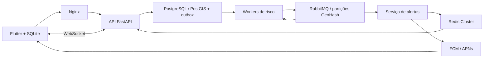

# EcoPulse — APS de Desenvolvimento de Sistemas Distribuídos

**Escopo atual (02/11/2026): Alagamento e Vias.** Os arquivos Word de outubro em `entregas/` são históricos e não incluem esta alteração. Para usar a versão atual, execute o código pelos comandos deste guia. APKs e ZIPs gerados ficam somente na máquina local e não são versionados.

App acadêmico em Flutter para Android e iOS, com demonstração em Ribeirão Preto. Entrega prevista: **30/10/2026**. A interface tem duas telas: mapa/lista e novo relato.

## Abrir a demonstração

O APK atualizado de 02/11/2026, versão **1.0.0+5**, remove Ar e Calor. O pacote local `entregas/EcoPulse-atualizado.apk` foi instalado e conferido no Android, preservando os relatos anteriores e sincronizando por Wi-Fi com `http://198.51.100.22:8000`. Confira os [metadados do pacote](entregas/ecopulse-atualizado-info.json). O servidor precisa permanecer em execução e o endereço deve acompanhar o IP do computador na rede. Para gerar um APK a partir deste repositório, veja os comandos de validação abaixo.

A [verificação atual dos serviços](docs/VERIFICACAO_APP_ATUAL.md) registra a correção das rotas, os testes de sincronização e os limites do modo demo.

Para obter os fontes, clone este repositório ou use **Code → Download ZIP** no GitHub. Credenciais, bancos locais e arquivos de compilação são ignorados pelo Git; copie `.env.example` para configurar seu ambiente e siga [CONFIGURAR_SERVICOS.md](docs/CONFIGURAR_SERVICOS.md) para as integrações externas. Os APKs e ZIPs históricos permanecem apenas na máquina em que foram gerados.

O pacote local `EcoPulse-Firebase-testes.apk`, versão **1.0.0+4**, de **06/10/2026**, é o último APK dos ensaios de outubro e ainda pode mostrar Ar e Calor. Seus [metadados históricos](entregas/firebase-tests-apk-info.json) e o [guia de entrega de outubro](entregas/COMO_USAR.md) foram preservados. O demo mantém Firebase desligado.

**O push geográfico Android passou no cenário ensaiado em 05/10**: um único relato fictício percorreu o backend full, o Android dentro do raio foi selecionado e o FCM aceitou uma única entrega. O usuário confirmou a chegada em segundo plano e a abertura ao tocar no APK daquele ensaio, sem observação independente do celular. [Prova do backend](docs/evidence/geographic-push.json), [confirmação humana](docs/evidence/geographic-push-phone-receipt.json). A exclusão fora do raio foi verificada com cadastro web sintético; não houve segundo telefone físico fora, movimento GPS ou iOS/APNs nesse ensaio. O [teste direto de 04/10](docs/evidence/fcm-phone-receipt.json) permanece como evidência do APK anterior.

Requisitos: Flutter, Python 3.11+ e Chrome ou um Android. No PowerShell, na pasta deste projeto:

```powershell
.\scripts\run_demo.ps1
```

Mantenha esse terminal aberto. Em outro terminal:

```powershell
.\backend\.venv\Scripts\python.exe scripts/seed_demo.py
.\scripts\run_mobile.ps1 -Device chrome
```

No emulador Android, use o dispositivo listado por `flutter devices`:

```powershell
.\scripts\run_mobile.ps1 -Device emulator-5554 -ApiUrl http://10.0.2.2:8000
```

No celular Android, conecte computador e celular à mesma rede e configure o IP do computador em **Conexão e informações**. Exemplo: `http://192.168.1.10:8000`. O servidor precisa estar acessível nessa rede. O APK acadêmico usa HTTP local e assinatura de desenvolvimento.

O modo `demo` usa SQLite no servidor e processamento local para apresentar as telas. Ele **não comprova a arquitetura distribuída**. Os relatos de exemplo de alagamento e vias obstruídas aparecem identificados como simulação. O navegador é uma prévia: sua fila usa armazenamento do navegador; Android/iOS usam SQLite nativo.

## Usar o app

1. Veja o mapa ou a lista e filtre Alagamento e Vias.
2. Toque em **Novo relato**, escolha tipo, gravidade e posição pelo GPS ou mapa. Há pontos de exemplo para a apresentação.
3. Salve o relato. O app grava primeiro no aparelho e tenta enviar em segundo plano.
4. Sem conexão, o relato fica pendente. Ao retomar a conexão ou tocar em atualizar, o app envia o mesmo UUID e evita duplicação.
5. Os detalhes mostram origem, horário, gravidade e caráter colaborativo ou simulado. Três instalações diferentes, dentro da janela espacial/temporal, aumentam a confiança; isso não é confirmação oficial.
6. Selecione origem e destino para pedir uma rota a pé ou de carro. Sem chave OpenRouteService, o app explica que o serviço não está configurado.

## Arquitetura distribuída



O backend tem três processos independentes: API, risco e alertas. Relato e evento são gravados na mesma transação. O relay publica com confirmação do broker. Os consumidores usam ack após processamento, deduplicação, retry e DLQ. As partições GeoHash distribuem mensagens; o PostgreSQL permanece um banco principal compartilhado com índice geoespacial. Isso demonstra particionamento do processamento, sem afirmar sharding físico do banco.

Veja [infraestrutura e cluster](docs/infra.md), [backend](docs/backend.md), [contrato da API](contracts/API.md) e [rastreabilidade dos requisitos](docs/REQUISITOS.md). O cluster completo executou testes reais no Docker deste Windows: fluxo por broker/cache, falhas de nós e recuperação. Consulte [VALIDACAO_INFRA.md](docs/VALIDACAO_INFRA.md) para resultados e limites da execução em um único host.

Para apresentar, siga o [roteiro atual de dez minutos, com versão reduzida](docs/APRESENTACAO_ATUAL.md).

## Serviços externos e iOS

A configuração de contas, downloads e chaves está em [CONFIGURAR_SERVICOS.md](docs/CONFIGURAR_SERVICOS.md). O app Android já está cadastrado no Firebase, com `mobile/android/app/google-services.json` válido para o pacote EcoPulse. A conta de serviço foi configurada e autenticada; o envio geográfico pelo backend full e o recebimento Android em segundo plano foram comprovados no ensaio de 05/10, sendo a recepção confirmada pelo usuário. A chave ORS também está configurada e as consultas reais pelo adaptador e pela API passaram. Apple Developer, Mac e iPhone continuam pendentes.

- **Rotas:** `ORS_API_KEY` está configurada no backend; consultas reais pelo adaptador e por `/v1/rotas` passaram, conforme [ROTAS.md](docs/ROTAS.md). O adaptador evita polígonos ativos e verifica geometria, pontos de acesso e ocorrências surgidas durante a consulta. Configuração e teste real em [ROTAS.md](docs/ROTAS.md).
- **Push:** registro e renovação de tokens, permissões, canal Android, seleção por raio e entrega FCM/APNs implementados. O ensaio de 05/10 comprovou PostgreSQL/outbox → RabbitMQ → risco → alertas → FCM, com um Android dentro do raio e confirmação humana da chegada em segundo plano e abertura por toque. Cadastros web sintéticos dentro/fora verificaram tratamento de plataforma e exclusão, sem representar um telefone físico distante. Em 06/10, primeiro plano foi confirmado pelo usuário na versão +3 e o mesmo Android, em etapa distinta com GPS recente, foi excluído fora do raio, sem novo recebimento confirmado. O percurso físico por GPS foi dispensado sem execução; iOS/APNs continuam pendentes. Use os scripts descritos em [PUSH.md](docs/PUSH.md). A configuração segue a [documentação oficial Firebase](https://firebase.google.com/docs/flutter/setup).
- **iOS:** código e permissões incluídos. É necessário Mac/Xcode para compilar e validar. Adicione `GoogleService-Info.plist` ao target Runner, habilite Push Notifications, configure APNs no Firebase e teste em iPhone. Não há IPA validado neste Windows.

Credenciais de serviço ficam no backend. `JWT_SECRET` e contas de infraestrutura são configurados localmente; nunca inclua essas credenciais no aplicativo. A sessão anônima identifica uma instalação e não substitui uma conta de usuário verificada.

## Validação

```powershell
.\backend\.venv\Scripts\python.exe -m pytest backend/tests -q
cd mobile
flutter analyze
flutter test
flutter build apk --debug --dart-define=API_BASE_URL=http://10.0.2.2:8000
flutter test integration_test/android_flow_test.dart -d emulator-5554
```

Os testes de integração Android dependem da API demo em execução na porta 8000. O teste grava um relato simulado, reabre SQLite e verifica envio pela API real. O estado do que foi efetivamente executado está em [VALIDACAO.md](docs/VALIDACAO.md).

As contagens a seguir são registros históricos da versão de outubro, anterior à retirada de Ar e Calor em **02/11/2026**; não representam a suíte atual. O backend passou com **162 testes em 04/10**. A revisão Flutter de **05/10/2026** passou com **45 testes**, análise sem problemas e teste do aviso pelo menu do mapa no emulador Android/SQLite. A atualização corrigiu a faixa que sumia após sincronizar; comportamento, evidências e limites estão em [PROXIMIDADE.md](docs/PROXIMIDADE.md). A contagem backend inclui nove testes novos da configuração local do demo. Firebase Android e servidor estão configurados; o fluxo geográfico full passou para um Android dentro do raio, com aceite FCM e confirmação humana de chegada/toque. As consultas ORS reais pelo adaptador e API passaram, e o usuário confirmou a rota aparecendo no celular. GPS pontual, salvamento offline, reabertura e reenvio Android também foram confirmados pelo usuário; o banco passou de 18 para 19 relatos, com um único novo UUID ligado a uma ocorrência, sem duplicação. Em 06/10 passaram 47 testes Flutter e análise sem problemas. Primeiro plano (+3) e ausência de novo recebimento fora do raio no mesmo Android (+4) foram confirmados pelo usuário; a exclusão foi conferida no backend. A carga isolada de 1.000 relatos também passou. O percurso físico por GPS foi dispensado sem execução; iOS/APNs continuam pendentes. O relatório e o roteiro Word foram produzidos; faltam preencher as atividades e assinaturas da ficha APS e ensaiar a apresentação.

## Pastas

| Pasta | Conteúdo |
|---|---|
| `mobile/` | App Flutter e projetos Android/iOS/web |
| `backend/` | API, workers, adaptadores, migração e testes |
| `infra/` | Docker Compose, cluster, replicação e balanceador |
| `scripts/` | Execução, seed e verificações |
| `contracts/` | Contratos usados pelos agentes para integração |
| `docs/` | Evidências, requisitos e orientação para a apresentação |


Em 05/10, o usuário confirmou também o aviso local de proximidade no Android físico, usando pontos manuais no mapa: faixa próxima e sem repetição após fechar/sair/voltar. [Evidência humana](docs/evidence/proximity-phone-confirmation.json). Esse ensaio local não testou movimento GPS físico ou FCM; a prova de push geográfico foi realizada separadamente, como descrito acima.

## Documentos da APS

Os arquivos de entrega e as evidências de outubro foram preservados como histórico da versão anterior; podem mostrar Ar e Calor. O projeto atual oferece Alagamento e Vias.

[Relatório Word](entregas/Relatorio_APS_EcoPulse.docx) e [roteiro Word](entregas/Roteiro_Apresentacao_EcoPulse.docx), com dados da equipe e do professor. O relatório segue a estrutura e as faixas de páginas da proposta; as evidências têm corte em 06/10. O roteiro distribui 10 minutos entre Vitória, Alessandro e Augusto e inclui uma versão reduzida de 6 minutos.

Preencha datas, participações, horas e assinaturas do registro APS com dados reais; confirme o formulário exigido pelo professor. Revise campus/data no roteiro e ensaie as falas. Fontes editáveis de apoio: [relatório](docs/RELATORIO_APS.md) e [apresentação](docs/APRESENTACAO_ATUAL.md). [Conferência documental](docs/evidence/academic-documents.json).

## Emulador Android

[Diagnóstico e comando para abrir o EcoPulse](docs/EMULADOR.md). O APK original abriu com mapa no emulador Android 14 preparado; a investigação encontrou pouca RAM disponível e travamentos dos serviços Android. Execute `pwsh -File scripts/iniciar_emulador.ps1` na raiz para reutilizar essa instância.

A divisão sugerida de responsabilidades está em [DIVISAO_EQUIPE.md](docs/DIVISAO_EQUIPE.md). Datas, horas reais e assinaturas serão preenchidas pela equipe. Use [ENSAIO_APRESENTACAO.md](docs/ENSAIO_APRESENTACAO.md) para conferir os dez minutos; o ensaio presencial ainda não foi executado pelo assistente.


Atualização documental em 06/10/2026: responsabilidades definitivas e horas confirmadas pela equipe (Vitória 21 h, Alessandro 23 h, Augusto 30 h). A equipe também declarou aprovação manual de iOS/APNs e do deslocamento físico por GPS, além da conclusão das revisões finais. Esses resultados são confirmações humanas, sem novos logs ou observação independente; datas de execução e detalhes do iPhone/APNs não foram informados. O relatório conserva as datas das provas técnicas e mantém assinaturas em branco. Registro: docs/evidence/academic-team-confirmation-20261006.json.
