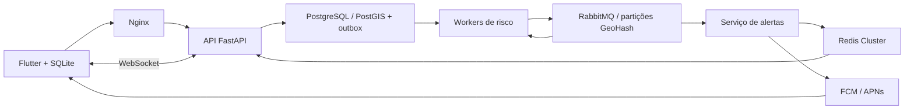

# EcoPulse — APS de Desenvolvimento de Sistemas Distribuídos

App acadêmico em Flutter para Android e iOS, com demonstração em Ribeirão Preto. Entrega prevista: **30/10/2026**. A interface tem duas telas: mapa/lista e novo relato.

## Abrir a demonstração

O APK Android de demonstração está em [entregas/EcoPulse-demo.apk](entregas/EcoPulse-demo.apk). O [arquivo de fontes](entregas/EcoPulse-fonte.zip) reúne código e documentação sem caches, bancos locais ou credenciais. Instale no Android e configure o endereço do backend em **Conexão e informações**. No emulador, o endereço inicial é http://10.0.2.2:8000; no celular, use o IP local do computador.

Requisitos: Flutter, Python 3.11+ e Chrome ou um Android. No PowerShell, na pasta deste projeto:

```powershell
.\scripts\run_demo.ps1
```

Mantenha esse terminal aberto. Em outro terminal:

```powershell
.\backend\.venv\Scripts\python.exe scripts/seed_demo.py
.\scripts\run_mobile.ps1 -Device chrome
```

No emulador Android, use o dispositivo listado por `flutter devices`:

```powershell
.\scripts\run_mobile.ps1 -Device emulator-5554 -ApiUrl http://10.0.2.2:8000
```

No celular Android, conecte computador e celular à mesma rede e configure o IP do computador em **Conexão e informações**. Exemplo: `http://192.168.1.10:8000`. O servidor precisa estar acessível nessa rede. O APK acadêmico usa HTTP local e assinatura de desenvolvimento.

O modo `demo` usa SQLite no servidor e processamento local para apresentar as telas. Ele **não comprova a arquitetura distribuída**. Os relatos e camadas de exemplo aparecem identificados como simulação. O navegador é uma prévia: sua fila usa armazenamento do navegador; Android/iOS usam SQLite nativo.

## Usar o app

1. Veja o mapa ou a lista e filtre Alagamento, Vias, Ar e Calor.
2. Toque em **Novo relato**, escolha tipo, gravidade e posição pelo GPS ou mapa. Há pontos de exemplo para a apresentação.
3. Salve o relato. O app grava primeiro no aparelho e tenta enviar em segundo plano.
4. Sem conexão, o relato fica pendente. Ao retomar a conexão ou tocar em atualizar, o app envia o mesmo UUID e evita duplicação.
5. Os detalhes mostram origem, horário, gravidade e caráter colaborativo ou simulado. Três instalações diferentes, dentro da janela espacial/temporal, aumentam a confiança; isso não é confirmação oficial.
6. Selecione origem e destino para pedir uma rota a pé ou de carro. Sem chave OpenRouteService, o app explica que o serviço não está configurado.

## Arquitetura distribuída



O backend tem três processos independentes: API, risco e alertas. Relato e evento são gravados na mesma transação. O relay publica com confirmação do broker. Os consumidores usam ack após processamento, deduplicação, retry e DLQ. As partições GeoHash distribuem mensagens; o PostgreSQL permanece um banco principal compartilhado com índice geoespacial. Isso demonstra particionamento do processamento, sem afirmar sharding físico do banco.

Veja [infraestrutura e cluster](docs/infra.md), [backend](docs/backend.md), [contrato da API](contracts/API.md) e [rastreabilidade dos requisitos](docs/REQUISITOS.md). O cluster completo executou testes reais no Docker deste Windows: fluxo por broker/cache, falhas de nós e recuperação. Consulte [VALIDACAO_INFRA.md](docs/VALIDACAO_INFRA.md) para resultados e limites da execução em um único host.

Para apresentar, siga o [roteiro de seis minutos](docs/APRESENTACAO.md).

## Serviços externos e iOS

- **AQI:** consulta real Open-Meteo/CAMS Global e exibição no app full validadas, com origem, escala e horário. É previsão modelada de grade, não estação local. No demo, valores fictícios identificados.
- **Ilhas de calor:** camada de exemplo identificada. Uma fonte real espacial de ilhas de calor ainda precisa ser integrada; temperatura do ar isolada não comprova uma ilha de calor.
- **Rotas:** defina `ORS_API_KEY` no backend. O adaptador envia polígonos a evitar e rejeita geometria que intersecta uma zona bloqueada.
- **Push:** forneça credenciais Firebase do servidor em `secrets/`, configure os arquivos nativos do app e compile com `--dart-define=FIREBASE_ENABLED=true`. A configuração segue a [documentação oficial Firebase](https://firebase.google.com/docs/flutter/setup). No Android, coloque `google-services.json` em `mobile/android/app/`; o plugin Gradle será aplicado quando o arquivo existir.
- **iOS:** código e permissões incluídos. É necessário Mac/Xcode para compilar e validar. Adicione `GoogleService-Info.plist` ao target Runner, habilite Push Notifications, configure APNs no Firebase e teste em iPhone. Não há IPA validado neste Windows.

Credenciais de serviço ficam no backend. `JWT_SECRET` e contas de infraestrutura são configurados localmente; nunca inclua essas credenciais no aplicativo. A sessão anônima identifica uma instalação e não substitui uma conta de usuário verificada.

## Validação

```powershell
.\backend\.venv\Scripts\python.exe -m pytest backend/tests -q
cd mobile
flutter analyze
flutter test
flutter build apk --debug --dart-define=API_BASE_URL=http://10.0.2.2:8000
flutter test integration_test/android_flow_test.dart -d emulator-5554
```

Os testes de integração Android dependem da API demo em execução na porta 8000. O teste grava um relato simulado, reabre SQLite e verifica envio pela API real. O estado do que foi efetivamente executado está em [VALIDACAO.md](docs/VALIDACAO.md).

A revisão final passou com **60 testes backend e 22 Flutter**, sem problemas na análise estática Flutter. Ainda faltam validação iOS, push/rotas reais, fonte espacial de calor, cache Redis das camadas ambientais e relatório formal/ficha APS. Firebase e OpenRouteService ainda não foram obtidos pela equipe. A matriz mantém esses requisitos como pendentes.

## Pastas

| Pasta | Conteúdo |
|---|---|
| `mobile/` | App Flutter e projetos Android/iOS/web |
| `backend/` | API, workers, adaptadores, migração e testes |
| `infra/` | Docker Compose, cluster, replicação e balanceador |
| `scripts/` | Execução, seed e verificações |
| `contracts/` | Contratos usados pelos agentes para integração |
| `docs/` | Evidências, requisitos e orientação para a apresentação |
